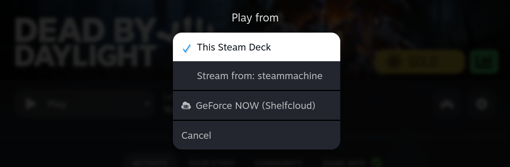

  

<h3 align="center">Cloud games, in your Steam Deck, Steam Machine and Bazzite library.</h3>

  
  
  
  
   
  
  

  <a href="#-getting-started">Getting Started</a> &middot;
  <a href="#-how-it-works">How it Works</a> &middot;
  <a href="#-supported-services">Services</a> &middot;
  <a href="#-features">Features</a> &middot;
  <a href="#-faq">FAQ</a>

---

## What is Shelfcloud?

Cloud gaming services like Boosteroid, GeForce NOW, Xbox Cloud and Amazon Luna don't show up in your Steam library — you have to open a browser, find the game, and launch it from there every time.

**Shelfcloud fixes that.** Pick your games on the [Shelfcloud website](https://shelfcloud.cc), and they appear as normal Steam tiles with proper artwork. Launching one opens the cloud provider and goes straight into the game. No extra steps.

  

 

## &#128640; Getting Started

### Prerequisites

- A **Steam account** — Shelfcloud uses Steam sign-in, no separate account needed
- A device running **SteamOS** or **Bazzite** (Steam Deck, Steam Machine, or any compatible hardware) with [Decky Loader](https://decky.xyz) installed
- A Chromium-based browser (Chrome, Edge, or Brave) — the plugin offers to install one for you if none is present, and automatically configures the flatpak permissions it needs (gamepad access for controller input in cloud streams)
- An account on one or more supported cloud gaming services

### Installation

Shelfcloud is still in beta and not yet on the official Decky store. You can install it today through [AlphaStore](https://alphastore.schelstraete.org), a community plugin store for Decky Loader:

1. Open **Decky Loader** settings on your device
2. Go to **Store** settings and select **Custom**
3. Enter: `https://alphastore.schelstraete.org`
4. Go back to the store, search for **Shelfcloud** and install

### First-time Setup

1. &#127918; Open the **Shelfcloud** panel from the Decky menu
2. &#128274; Press **Sign in with Steam** — the website opens; sign in there
3. &#128296; Under **Settings**, choose your browser (Chrome/Edge/Brave)
4. &#127911; Select games on the Shelfcloud website
5. &#128260; Press **Sync now** — your games appear as Steam tiles with artwork

From here on, newly selected games sync automatically in the background.

 

## &#9881;&#65039; How it Works

Shelfcloud is a **sync agent**, not a game browser. The workflow is split:

| Layer | Responsibility |
|---|---|
| &#127760; **Website** | Browse the catalog, select games, manage your library — from any device |
| &#128268; **Decky plugin** | Sync your choices to Steam, apply artwork, handle launches |
| &#128424; **Gateway** | Serve the catalog and resolve artwork |

The plugin polls the gateway on a configurable interval (default: every 5 minutes, or **Off** to sync only when you press Sync now) and reconciles your Steam library — adding new tiles, removing ones you un-selected, and updating artwork when better art becomes available.

### Shelves

A **shelf** is a named collection of games you curate on the Shelfcloud website. Each device can be pointed at a different shelf, or at the shared library that every device sees.

This is useful when you have multiple devices — say, a Steam Deck for portable play and a Steam Machine in the living room. The Deck might get a shelf with games that work well on a small screen and controller, while the living room machine gets a shelf tuned for big screen and higher bandwidth. Games you add to the shared library appear on every device; games on a shelf appear only on devices pointed at that shelf.

You manage shelves on the website and pick which shelf a device uses from **Settings** in the Decky panel. The plugin identifies itself by device name so you can tell your devices apart.

### Browser Setup

If no supported browser is installed, the plugin offers to install one — Edge or Chrome — directly from the panel via flatpak. After installation it automatically applies the sandbox permissions cloud gaming needs, such as access to `/run/udev` so gamepads are visible to the stream. You can re-apply these permissions any time from **Settings > Fix gamepad permissions**.

### Launching a Game

When you launch a tile, a small launcher script:

1. Opens the chosen browser with a dedicated profile
2. Navigates to the provider's game page
3. Waits for the page to load and presses **Play** automatically

Your provider credentials stay in the browser profile — Shelfcloud never sees them.

 

## &#127463;&#127480; Supported Services

| Service | Status |
|---|---|
| &#9729;&#65039; **Boosteroid** | &#9989; Fully supported |
| &#127918; **GeForce NOW** | &#9989; Fully supported |
| &#127775; **Xbox Cloud Gaming** | &#9989; Fully supported |
| &#128038; **Amazon Luna** | &#9989; Fully supported |
| &#128279; **Custom URL** | &#9989; Add your own |

You can also add a **custom provider** by pasting any URL on the Shelfcloud website. This creates a tile that opens that URL in the browser — useful for services Shelfcloud doesn't cover yet, or for your own game server.

Boosteroid and GeForce NOW stream games you already own. Xbox Cloud Gaming and
Amazon Luna are the other kind — the subscription *is* the catalog, so owning a
game on Steam grants nothing there. Both are **off by default** and must be
switched on in **Settings** on the website, so a tile never launches into a
paywall you did not ask for.

Both also sell more than one plan, with different games on each (Game Pass
Essential/Premium/Ultimate, Luna with Prime or Luna Premium). Tell Shelfcloud
which one you have and games above it are marked, instead of failing at the
paywall after you have already added them.

More providers may be added over time. Shelfcloud does not buy subscriptions or access for you — you'll need whatever each service requires.

 

## &#128293; Features

- **&#127912; Full artwork** — capsule, header, hero, logo, and icon for every game
- **&#127918; Per-game customisation** — every game is a real Steam shortcut, so you can set a custom icon, change the artwork, and assign a controller layout per game — just like any other title in your library
- **&#128260; Background sync** — games appear on their own after you pick them
- **&#128274; Steam sign-in** — no extra accounts; sign in with your existing Steam identity
- **&#127918; One-click launch** — tile opens the browser and starts the game automatically
- **&#128218; Bulk import** — "Add all my games" finds every Steam game you own that's also on a cloud service
- **&#128268; Multi-provider** — one library, multiple cloud services, one Deck
- **&#127918; A tile per service** — optionally give a game its own tile for each service it's on, one in each provider's collection, instead of a single tile on the best service
- **&#128218; Shelves** — curate different game lists for different devices; each device picks its shelf from Settings
- **&#128247; Per-provider chips** — see at a glance how your library breaks down
- **&#128268; Browser installer** — no browser? The plugin installs Edge or Chrome for you straight from the panel
- **&#127918; Gamepad permissions** — flatpak overrides for controller access are applied automatically; a manual "Fix gamepad permissions" button is available in Settings if needed
- **&#128249; Hardware video decode** — VA-API is enabled automatically for smoother streaming and better battery life
- **&#128736; Device identity** — each device registers its name (Steam Deck, Steam Deck OLED, or the machine's hostname) so you can tell them apart on the website
- **&#128274; Pairing code sign-in** — a code is shown on the panel before Steam's browser opens, so you can finish sign-in even after the panel closes
- **&#127991; Service badge** — a cloud tile's game page and its card in the library show which service streams it; the corner is yours to pick, or switch it off
- **&#128101; Players online** — optional badge with how many people play the game on Steam right now, also for cloud tiles where Steam can't show it itself
- **&#9654;&#65039; Play it on another service** — on a game page you get your other cloud services that have the game. On a Steam game they are in the dropdown next to Play. On a cloud tile, or when Steam shows no dropdown, a small Shelfcloud button next to Play opens them — so Fortnite on GeForce NOW offers Fortnite on Boosteroid too. Can be switched off in Settings

  
   
  Dead by Daylight on a Steam Deck: next to playing it local or streaming it from the PC, GeForce NOW is offered too.

 

## &#10067; FAQ

<strong>Why do I need a browser installed?</strong>

Cloud gaming providers offer standalone desktop clients, but those don't support launching a specific game directly — you'd still have to navigate to the game yourself. A browser lets Shelfcloud open the exact game page and press Play for you. Steam's built-in browser forwards no controller input to web pages, so games need a real Chromium browser (Chrome, Edge, or Brave) that supports the video codecs and gamepad APIs cloud providers require. Firefox is not supported for this reason.

<strong>Can I use this on desktop Steam?</strong>

Yes — Decky Loader runs on any Linux machine with Steam in Big Picture mode, including desktops and laptops running SteamOS or Bazzite. If you can install Decky, the plugin works the same way it does on a Steam Deck.

<strong>What happens when the gateway is unreachable?</strong>

Games still launch from their last known link. Syncing pauses until the gateway is back, then catches up on the next poll. It's rarely fatal.

<strong>Does Shelfcloud see my provider passwords?</strong>

No. Provider sign-ins happen in the browser's own profile. Shelfcloud never touches, transmits, or stores those credentials. See <a href="SECURITY.md">SECURITY.md</a> for more detail.

<strong>Can my Steam friends see which game I'm playing?</strong>

Yes. Each tile is named after its game and service &mdash; for example, `Valheim (Boosteroid)` &mdash; and Steam shows that name to your friends while you play, exactly as it does for any other game. This is standard Steam presence, not something Shelfcloud adds. If you'd rather not broadcast it, hide your game activity in Steam's privacy settings or set your status to invisible.

<strong>What's the difference between shelves and the shared library?</strong>

The **shared library** is your default game list — every device sees it. A **shelf** is an optional, named subset you create on the website. When you point a device at a shelf, it syncs only the games on that shelf (plus the shared ones). This lets you tailor each device without removing games from other devices. If you only have one device, you don't need shelves — the shared library is all you need.

<strong>My controller doesn't work in the cloud stream</strong>

Flatpak browsers are sandboxed and don't have access to input devices by default. Shelfcloud applies the needed permissions automatically when it installs a browser, and on every plugin startup. If your gamepad still isn't detected, go to **Settings > Fix gamepad permissions** and try again. This runs `flatpak --user override --filesystem=/run/udev:ro` on your selected browser.

<strong>Can I customise individual games?</strong>

Yes. Every cloud game Shelfcloud adds is a normal Steam shortcut, so you can do everything Steam allows for non-Steam games: set a custom icon, replace the artwork (capsule, hero, header, logo), assign a per-game controller layout, rename the tile, or add launch options. Your changes are kept across syncs — Shelfcloud only updates artwork when it finds something better, and never overwrites a layout you set.

<strong>How do I report a bug?</strong>

Open an issue on <a href="https://github.com/bschelst/shelfcloud-decky/issues">GitHub</a>. Include your plugin version (shown in the About section of the panel) and any relevant lines from <code>~/homebrew/logs/Shelfcloud/shelfcloud-launch.log</code>.

 

## Disclaimer

Shelfcloud is an independent, open-source project. It is **not affiliated with,
endorsed by, or sponsored by** Valve, Steam, Microsoft, Xbox, NVIDIA, GeForce
NOW, Boosteroid, Amazon, Amazon Luna, or any other service named here. All product names, logos and
trademarks are the property of their respective owners, and are used only to
say which service carries which game.

Shelfcloud opens a provider's own URL in your own browser, using your own
subscription. It does not proxy, rehost, resell or circumvent any service, and
it neither provides nor includes access to any of them — you need whatever
subscription each game already requires.

## &#128220; License

This project is licensed under the [GNU General Public License v2.0](LICENSE).

 

  Made with &#9749; by <a href="https://github.com/bschelst">Bart Schelstraete</a>

