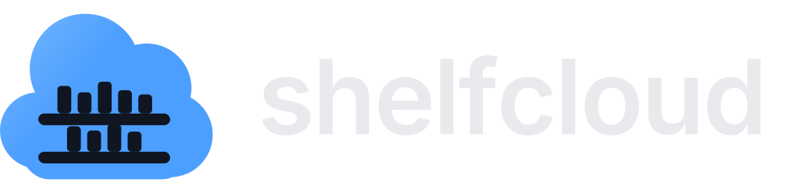

  

<h3 align="center">Cloud games, in your Steam Deck, Steam Machine and Bazzite library.</h3>

  
  
  
  

  <a href="#-getting-started">Getting Started</a> &middot;
  <a href="#-how-it-works">How it Works</a> &middot;
  <a href="#-supported-services">Services</a> &middot;
  <a href="#-faq">FAQ</a>

---

## What is Shelfcloud?

Cloud gaming services like Boosteroid, GeForce NOW, and Xbox Cloud don't show up in your Steam library — you have to open a browser, find the game, and launch it from there every time.

**Shelfcloud fixes that.** Pick your games on the Shelfcloud website, and they appear on your Steam Deck as normal tiles with proper artwork. Launching one opens the cloud provider and goes straight into the game. No extra steps.

 

## &#128640; Getting Started

### Prerequisites

- A **Steam Deck** running SteamOS with [Decky Loader](https://decky.xyz) installed
- A Chromium-based browser (Chrome, Edge, or Brave) — the plugin offers to install one for you if none is present, and automatically configures the flatpak permissions it needs (gamepad access for controller input in cloud streams)
- An account on one or more supported cloud gaming services

### Installation

Shelfcloud is still in beta and not yet on the official Decky store. You can install it today through [AlphaStore](https://alphastore.schelstraete.org), a community plugin store for Decky Loader:

1. Open **Decky Loader** settings on your Steam Deck
2. Go to **Store** settings and select **Custom**
3. Enter: `https://alphastore.schelstraete.org`
4. Go back to the store, search for **Shelfcloud** and install

### First-time Setup

1. &#127918; Open the **Shelfcloud** panel from the Decky menu
2. &#128274; Press **Sign in with Steam** — the website opens; sign in there
3. &#128296; Under **Settings**, choose your browser (Chrome/Edge/Brave)
4. &#127911; Select games on the Shelfcloud website
5. &#128260; Press **Sync now** — your games appear as Steam tiles with artwork

From here on, newly selected games sync automatically in the background.

 

## &#9881;&#65039; How it Works

Shelfcloud is a **sync agent**, not a game browser. The workflow is split:

| Layer | Responsibility |
|---|---|
| &#127760; **Website** | Browse the catalog, select games, manage your library — from any device |
| &#128268; **Decky plugin** | Sync your choices to Steam, apply artwork, handle launches |
| &#128424; **Gateway** | Serve the catalog, resolve artwork, track what you play |

The plugin polls the gateway on a configurable interval (default: every 5 minutes) and reconciles your Steam library — adding new tiles, removing ones you un-selected, and updating artwork when better art becomes available.

### Browser Setup

If no supported browser is installed, the plugin offers to install one — Edge or Chrome — directly from the panel via flatpak. After installation it automatically applies the sandbox permissions cloud gaming needs, such as access to `/run/udev` so gamepads are visible to the stream. You can re-apply these permissions any time from **Settings > Fix gamepad permissions**.

### Launching a Game

When you launch a tile, a small launcher script:

1. Opens the chosen browser with a dedicated profile
2. Navigates to the provider's game page
3. Waits for the page to load and presses **Play** automatically

Your provider credentials stay in the browser profile — Shelfcloud never sees them.

 

## &#127463;&#127480; Supported Services

| Service | Status |
|---|---|
| &#9729;&#65039; **Boosteroid** | &#9989; Fully supported |
| &#127918; **GeForce NOW** | &#9989; Fully supported |
| &#127775; **Xbox Cloud Gaming** | &#9989; Fully supported |

More providers may be added over time. Shelfcloud does not buy subscriptions or access for you — you'll need whatever each service requires.

 

## &#128293; Features

- **&#127912; Full artwork** — capsule, header, hero, logo, and icon for every game
- **&#128260; Background sync** — games appear on their own after you pick them
- **&#128274; Steam sign-in** — no extra accounts; sign in with your existing Steam identity
- **&#127918; One-click launch** — tile opens the browser and starts the game automatically
- **&#128218; Bulk import** — "Add all my games" finds every Steam game you own that's also on a cloud service
- **&#128268; Multi-provider** — one library, multiple cloud services, one Deck
- **&#128247; Per-provider chips** — see at a glance how your library breaks down
- **&#128268; Browser installer** — no browser? The plugin installs Edge or Chrome for you straight from the panel
- **&#127918; Gamepad permissions** — flatpak overrides for controller access are applied automatically; a manual "Fix gamepad permissions" button is available in Settings if needed
- **&#128218; Built-in help** — a full help & documentation modal accessible from the panel, covering setup, playing, syncing, troubleshooting, and privacy

 

## &#10067; FAQ

<strong>Why do I need a browser installed?</strong>

Cloud gaming providers offer standalone desktop clients, but those don't support launching a specific game directly — you'd still have to navigate to the game yourself. A browser lets Shelfcloud open the exact game page and press Play for you. Steam's built-in browser forwards no controller input to web pages, so games need a real Chromium browser (Chrome, Edge, or Brave) that supports the video codecs and gamepad APIs cloud providers require. Firefox is not supported for this reason.

<strong>Can I use this on desktop Steam?</strong>

The plugin is built for Decky Loader, which runs on the Steam Deck. Desktop Steam doesn't support Decky plugins. You could adapt the sync logic, but that's not an offical use case today.

<strong>What happens when the gateway is unreachable?</strong>

Games still launch from their last known link. Syncing pauses until the gateway is back, then catches up on the next poll. It's rarely fatal.

<strong>Does Shelfcloud see my provider passwords?</strong>

No. Provider sign-ins happen in the browser's own profile. Shelfcloud never touches, transmits, or stores those credentials. See <a href="SECURITY.md">SECURITY.md</a> for more detail.

<strong>My controller doesn't work in the cloud stream</strong>

Flatpak browsers are sandboxed and don't have access to input devices by default. Shelfcloud applies the needed permissions automatically when it installs a browser, and on every plugin startup. If your gamepad still isn't detected, go to **Settings > Fix gamepad permissions** and try again. This runs `flatpak --user override --filesystem=/run/udev:ro` on your selected browser.

<strong>How do I report a bug?</strong>

Open an issue on <a href="https://github.com/bschelst/shelfcloud-decky/issues">GitHub</a>. Include your plugin version (shown in the About section of the panel) and any relevant lines from <code>~/homebrew/logs/shelfcloud-launch.log</code>.

 

## Disclaimer

Shelfcloud is an independent, open-source project. It is **not affiliated with,
endorsed by, or sponsored by** Valve, Steam, Microsoft, Xbox, NVIDIA, GeForce
NOW, Boosteroid, or any other service named here. All product names, logos and
trademarks are the property of their respective owners, and are used only to
say which service carries which game.

Shelfcloud opens a provider's own URL in your own browser, using your own
subscription. It does not proxy, rehost, resell or circumvent any service, and
it neither provides nor includes access to any of them — you need whatever
subscription each game already requires.

## &#128220; License

This project is licensed under the [GNU General Public License v2.0](LICENSE).

 

  Made with &#9749; by <a href="https://github.com/bschelst">Bart Schelstraete</a>

